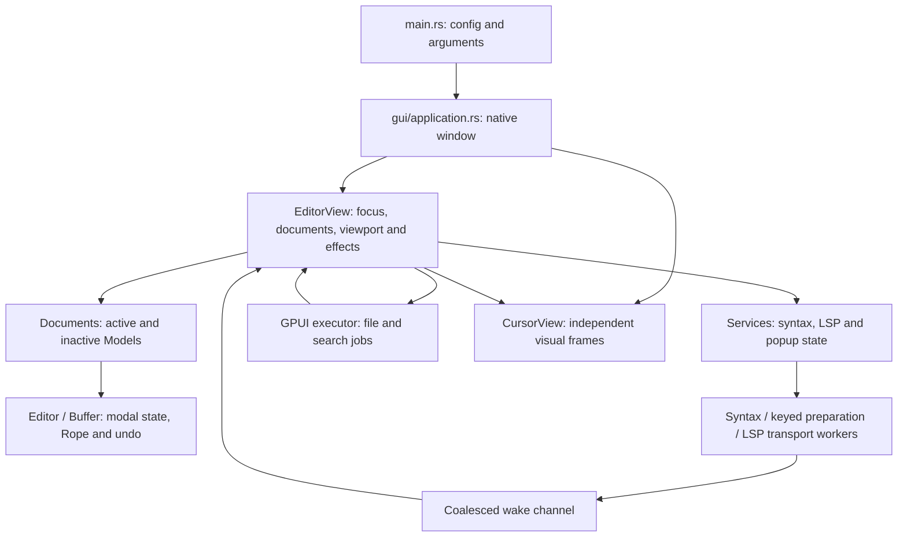

# Filavim native architecture

This map describes FilaVim on `main`. Start at the
subsystem responsible for a change, inspect its types and callers, then follow
only the relevant flow. [AGENTS.md](../AGENTS.md) defines engineering conventions;
[TESTING.md](TESTING.md) defines verification and coverage limits.

## Active application boundary

[Cargo.toml](../Cargo.toml) is a single package, not a multi-crate workspace.
The default `native` feature enables GPUI **0.2.2** and image decoding. The
`filavim` binary requires `native`; `gpui-tests`, `test-tools` and `perf` are opt-in.
[src/lib.rs](../src/lib.rs) and [gui/mod.rs](../src/gui/mod.rs) define the active
module graph. Several `gui` adapters compile without GPUI for headless testing.

Historical terminal sources such as `app.rs`, `runtime.rs`, `ui.rs`, `terminal.rs`,
`workspace_ui.rs`, `smear.rs`, `pixiedust.rs` and `font/` are **not declared by these
native entry modules**. Their presence is not evidence of a migrated feature.
The native application neither embeds a terminal nor invokes Neovim. Keep the
original terminal worktree separate; do not revive old UI paths to fix native ones.

## Ownership and source map

| Responsibility | Implementation and boundary |
|---|---|
| Bootstrap/window | [main.rs](../src/main.rs) loads config and dispatches CLI/smoke modes. [gui/application.rs](../src/gui/application.rs) registers embedded Agave, creates the native window and routes close requests. |
| Editing authority | [buffer.rs](../src/buffer.rs) owns Rope, cursor, journal and undo snapshots. [editor.rs](../src/editor.rs) owns modal state, selection, commands and pairing. |
| Input | [gui/input.rs](../src/gui/input.rs) translates GPUI keys; [input.rs](../src/input.rs) resolves semantic `Action`s. [gui/model.rs](../src/gui/model.rs) handles committed text and IME ranges around one real Editor. |
| Multiple documents | [gui/documents.rs](../src/gui/documents.rs) owns the active Model and inactive Models. Switching moves them; text/history is not rebuilt. Document IDs, paths and tab order are distinct identities. |
| UI coordination | [gui/view.rs](../src/gui/view.rs), `EditorView`: routes focus/keys/commands, dispatches effects, owns service/explorer adapters and visible-row cache. `manager_view.rs` is its child module via `#[path]`. |
| Viewport/shaping | [gui/viewport.rs](../src/gui/viewport.rs), `VisibleLine`: clipped display strings and scalar/byte mapping. `EditorView::prepare` shapes visible rows and reuses compatible cached rows; `paint` draws geometry/decorations. |
| Cursor | [gui/cursor.rs](../src/gui/cursor.rs) is time-based four-corner simulation; [cursor_view.rs](../src/gui/cursor_view.rs) owns GPUI scheduling/clipping. The root caches editor content separately from cursor frames. No particles. |
| Language services | [gui/services.rs](../src/gui/services.rs), `Services`: document sync, server selection/runtime instances, pending requests, syntax snapshots, diagnostics and popup state. `update`, `poll`, `request`, `accept` are the main integration points. |
| Completion | [gui/completion.rs](../src/gui/completion.rs), `Session`/`Source`: context lifetime, provider snapshots, matching and edit rebasing. [completion_context.rs](../src/gui/completion_context.rs) provides conservative local TypeScript type keywords. |
| Popup policy/chrome | [gui/popup.rs](../src/gui/popup.rs): headless placement and input routing. [floating.rs](../src/gui/floating.rs): shared GPUI styling/content helpers. The view owns focus, keyboard/mouse dispatch and popup rendering. |
| Notifications | [gui/toast.rs](../src/gui/toast.rs): controlled-time, bounded lifetime/stack model. [toast_view.rs](../src/gui/toast_view.rs): native translucent overlay, independent entity and single owned animation timer. Services queues application notices; command feedback remains in Editor. |
| LSP transport | [lsp.rs](../src/lsp.rs), `Client`: process threads, framed JSON-RPC, initialization, synchronization, cancellation, events and shutdown. It never mutates editor state. |
| LSP installation | [lsp_catalog.rs](../src/lsp_catalog.rs) defines curated packages; [lsp_manager.rs](../src/lsp_manager.rs) owns receipts/preferences/resolution and asynchronous tool operations. `gui/manager_view.rs` renders their real state. Installation and runtime status are separate. |
| Syntax | [syntax.rs](../src/syntax.rs), `SyntaxService`: Tree-sitter jobs coalesce per document; results carry generation/revision identity. `project_highlights` retains viewport-relevant old highlighting across edits. |
| Files/search | [gui/io.rs](../src/gui/io.rs): `Job`/`Done` snapshot protocol. [files.rs](../src/files.rs) performs synchronous UTF-8 reads, atomic saves and literal Rope search; callers schedule disk work off-thread. |
| Explorer/project search | [gui/explorer.rs](../src/gui/explorer.rs) owns native tree state and indexing/projection workers. [navigation.rs](../src/navigation.rs) implements ignore-aware indexing, fuzzy ranking, regex grep, rows and bounded previews. |
| Git/utilities | [git.rs](../src/git.rs) provides subprocess jobs/results. Native commands in `EditorView` dispatch supported operations and present rows through Services; transport/installation does not own this UI. |
| Settings/appearance | [config.rs](../src/config.rs): validated native/core settings. [appearance.rs](../src/appearance.rs): theme/background options and persistence; [palette.rs](../src/palette.rs): RGB palettes; [gui/theme.rs](../src/gui/theme.rs): resolved semantic GPUI colors. |
| Wallpaper/font | [gui/wallpaper.rs](../src/gui/wallpaper.rs) bounds decoding off-thread and retains a reusable GPUI image with stale-load protection. Embedded Agave constants are in `gui/mod.rs`; provenance/notices are in [assets/fonts](../assets/fonts/README.md). |
| Shared worker primitives | [background.rs](../src/background.rs): replaceable/keyed jobs, cooperative cancellation and wakes. [queue.rs](../src/queue.rs): nonblocking producers plus approximate queue-volume/age metrics; not a capacity-limited queue. |

## Input, coordinates and rendering

Key events enter `EditorView::key`, pass popup/focus routing, then the active
Model/keymap and `Editor::act`. Text/IME uses the view's `EntityInputHandler` and
Model's text methods. User character typing reaches `Editor::type_character` and
[pairs.rs](../src/pairs.rs); paste/composition/programmatic edits have separate
paths so pairing is not recursively applied. Do not add another Vim dispatcher.

Buffer edits update revision, undo state, bounded edit history and display caches.
`EditorView::changed` calls `Services::update`, advances automatic completion when
logical identity changes, and requests a GPUI update. Rendering consumes the real
buffer through visible fragments, not a second document representation.

Coordinate units must remain explicit:

- Buffer cursor, selections and edit ranges: Unicode scalar indices, with navigation
  at grapheme boundaries. Saved-state identity is separate from monotonic revision.
- Syntax `Highlight::range`, Tree-sitter edits and viewport queries: UTF-8 bytes.
- `VisibleLine::boundaries`: absolute document scalars paired with bytes in the
  displayed fragment; tabs/control sanitization changes that display string only.
- GPUI text-input/composition ranges: UTF-16, converted by Model. Pixel positions
  come from shaped text, not byte counts or assumed Unicode widths.
- LSP positions: the server's negotiated encoding. `lsp.rs` exposes transport/edit
  conversions; [coordinates.rs](../src/coordinates.rs) supplies journal coordinate
  bookkeeping used by Buffer. Do not assume these are one unified helper module.

Cursor targets derive from shaped logical positions in window coordinates. The
cursor entity animates presentation only, including command-line transitions;
document/layout incompatibility can snap it. Frame scheduling ends after settling
and is suppressed appropriately when inactive. Never feed interpolated positions
back into editing or reshape the document just because a corner moved.

## Asynchronous lifecycles

### File operations and documents

`Editor::act`/commands return typed `Request`s. `EditorView::request` handles
clipboard/quit directly and dispatches file/search `Job::run` via GPUI's background
executor. The view admits one file job at a time, while editing can continue. Document
search has its own debounced generation/task and never holds the file busy flag.
Ordinary Open adds or switches a document; reload uses document/revision validation.
Save/search results route to their owning document, including inactive tabs.

File-backed Buffers retain the disk state returned by a verified open or save.
`files::DiskState` combines streaming SHA-256 content verification with creation
and modification metadata plus platform file identity; typing does not read disk. Save jobs carry the expected
baseline and paths owned by other documents. The background job resolves paths,
checks destination ownership, verifies the baseline before writing and again
immediately before atomic replacement, and verifies the written content before
acknowledgment. Conflict results return to the native confirmation panel with
Reload, Keep, Save copy and a separately confirmed Overwrite decision. Overwrite
uses the observed conflict baseline, so another external change rejects it again.
Generic filesystem APIs cannot provide an atomic compare-and-replace against
uncooperative external writers; a narrow check-to-rename race remains.

A save writes its captured Rope/state snapshot. Completion acknowledges that saved
state, so newer edits remain dirty. Search results require matching revision.
Dirty close/quit uses the existing confirmation flow; never bypass it to simplify UI.

### Recovery snapshots

`recovery.rs` owns a coalescing local snapshot worker. `EditorView::changed`
publishes changed Rope roots for active and inactive documents, and publishes
removals after save or deliberate close/discard. A 750ms debounce is capped at
two seconds during sustained typing. Each document snapshot is limited to 16 MiB
and atomically replaces its previous synced JSON snapshot. Storage is beside the
native config in `recovery/session-*`; session locks exclude running instances.
Startup offers abandoned sessions through the existing native decision overlay.
Recovered documents are dirty buffers, never automatic disk writes; their stored
disk baseline participates in normal conflict checks. Original recovery entries
remain until a replacement snapshot is durable, or a successful save/deliberate discard. Shutdown asynchronously
flushes pending cleanup before exit. TestWindow fixtures disable automatic access
to persistent recovery storage; storage tests use isolated temporary directories.

### LSP, completion and syntax

`Services::update` resolves selected tools/project roots and lazily starts compatible
server instances. The installer resolves executables; `lsp::Client` handles process
startup/initialize and emits readiness/capability events. Opening/editing/saving/
closing documents schedules protocol synchronization. No service wait belongs in paint.

The manager gates both executable discovery and activation on project trust.
The worker verifies the approved directory identity and resolves contained document
and server roots before Services may start a project process. Trust is persisted
with manager receipts and changing trust invalidates the resolved snapshot.
The native overlay requests changes through the same worker as other manager
operations. Managed tools can be staged and probed in isolated temporary workspaces.

Completion flow:

1. `changed` / typed triggers / explicit invocation reach `automatic_completion`
   or `request_completion` after document reconciliation.
2. A compatible `Session` persists across prefix edits. Existing sources filter
   immediately; contextual local TypeScript keywords can publish without an LSP.
3. Providers refresh asynchronously as needed; incomplete lists and trigger
   characters have distinct request behavior. Pending request identity is separate
   from session identity and popup visibility.
4. Transport replies enter `Services::poll`; expensive preparation uses the shared
   keyed worker. Server-event collection rotates and yields on count/time budgets.
5. Publication validates context/request identity and provider revisions. Candidates
   can be rebased through retained prefix edits; an old revision is not automatically
   useless, but unavailable history or incompatible edits must reject reuse.
6. The view renders `Panel` rows with stable session identity, preserves appropriate
   selection and accepts through `Services::accept`. Replacement/additional edits
   are validated against current documents; snippets use existing expansion support.

Signature help has its own panel state so completion and parameter assistance can
coexist. Hover/diagnostics/actions use existing native floating presentations.
Request routing belongs in Services, placement in `popup.rs`, styling in
`floating.rs`; do not make the status line another interactive selection model.

Syntax jobs/results carry document, revision and generation. Services validates all
three, retains live-document state, and requests viewport projection of old spans
while new parses run. Highlights use bytes; do not transform them as scalar ranges.

### Scheduling and shutdown

`LatestWorker` replaces one pending job; `KeyedWorker` preserves independent keys
on one preparation thread. Cancellation checks generations cooperatively. The LSP
queues cap admitted work at 256 messages and 32 MiB of estimated payload per queue.
Initialization backlog and pending requests have separate limits. Overflow closes
the transport, delivers a terminal error and leaves retry policy with Services.
These limits are per transport and payload estimates do not measure total heap use.

Workers call `background::wake`; the view drains a capacity-one async notification
channel and polls services/explorer. This coalesces wakes rather than polling every
16 ms. `WakeGuard` is currently one process-wide callback, not multi-window routing.
Worker Drop signals closure without UI-thread joins. Services controls retirement
and shutdown of LSP clients; process failures do not authorize unlimited restart loops.

## Toast notification contract

Use `toast::Notification::new(Category, title, message)` for application events.
Defaults are success/info/warning/error = 3/4/5/7 seconds, after a 180 ms entrance;
`for_duration` overrides the deadline and `persistent` requires explicit dismissal.
`ToastView::show` runs on the UI thread, including an entity update after awaiting
background work. Services has a bounded queue drained by EditorView; do not call
GPUI entities directly from process threads. `EditorView::toast` is the native helper.

Toasts are deferred above editor/popups in the top-right, below the custom title
row, and do not reserve editor layout or request keyboard focus. Surfaces use a
28% theme-base alpha tint, not an opaque imitation of the wallpaper. Shared strings
are retained; the overlay does not notify/rebuild the editor on lifetime frames.
One owned GPUI executor timer requests updates around 60 Hz only while needed.
Reduced motion (`cursor.reduced_motion`) removes slide/fade; lifetime progress
remains, updating around 30 Hz. Hover pauses countdown and stops timer work once
the entrance settles. Exit lasts 220 ms; all timing uses monotonic elapsed time.
The header timestamp is display-only UTC wall time. Closing uses the small ×.

The stack is newest first and capped at three. Duplicate visible title/message/
category notices reuse their existing ID without extending lifetime. Under pressure
the oldest ordinary toast is replaced; persistent items are protected. If all three
are persistent, `show` returns None rather than allocating an unbounded backlog.
Text is bounded to 64 title/600 message characters and the displayed message area
is clipped for compactness; detailed errors remain in existing manager/error state.
On very short windows the stack is clipped to available window height.

Current producers: appearance setting success/failure, wallpaper errors, LSP
readiness/failure and explicit stop/restart requests, diagnostic-limit warnings,
and installer start/completion/failure milestones. Regular file/command feedback
(`:w`, search results, prompts), mode labels and typing do not become toasts.
Manager progress/details remain in its existing panel; notifications do not replace
troubleshooting state or create another interactive command interface.

Controlled-time tests live in `toast.rs`; the GPUI integration test covers an async
notice, focus/command preservation, resize, dismissal and unchanged editor shapes.
For manual appearance checks: use `:set theme.variant=muted` (restore with
`:set theme.variant=dark`), hover
the notice to pause its line, move off to resume, then use ×; type in Insert and
command modes while it is visible. LSP readiness/failure notices require an enabled
server. Confirm wallpaper remains visible through the panel and idle work stops.

## Finding the right change and keeping this map current

Use the ownership table to choose a file, search its responsible symbol and callers,
then inspect the closest tests. For example, completion flicker starts at Session,
`Services::publish_completion` and `EditorView::changed`/`accept_popup`; a misplaced
popup starts at `popup::place`/`assistance` and the view's caret geometry. A save
race starts at `Request::Save`, `gui::io::apply` and document routing, not paint.

Keep contracts beside code with `///`, module boundaries with `//!`, and only
non-obvious reasons in `//`. Update this map for ownership/interface/data-flow
changes, not every implementation adjustment. Remove stale comments when touching
the relevant code. Update AGENTS for workflow/layout changes; link focused guides
instead of duplicating them: [completion/pairs](../COMPLETION_AND_PAIRS.md),
[LSP manager](../LSP_MANAGER.md), [theme/wallpaper](../CYBERDREAM.md),
[cursor/checkpoints](../GPUI_CHECKPOINTS_3_4.md).

## Everyday editing additions

[EDITING_AND_SAFETY.md](EDITING_AND_SAFETY.md) documents native commands and limits.
`search.rs` evaluates literal/regex/capture replacement snapshots on the existing
I/O executor. `gui::io::apply` validates revision before one undoable replacement.
The view consumes scalar match ranges and clips them to visible rows; edits hide
stale ranges. `editing.rs` supplies line comment/indent transactions and conservative
indent detection, evaluated on the background open job. `Action` centrally and
exhaustively classifies unavailable native features for default binding filtering,
user-config validation and explicit-command feedback. Regex is now a direct
`regex` dependency (already transitively present) because captures and replacement
expansion are not exposed by the existing grep matcher interface.

## Stabilization boundaries

`gui/search_refresh.rs` is a child of EditorView, scheduling the existing search
jobs independently of the file busy flag. Automatic scans debounce 150ms; one
owned task/generation supersedes previous work. Publication checks document,
revision, query, options and generation. Cancellation is cooperative between
matches; a single regex engine scan is not interrupted. Automatic publication
never moves the cursor, switches mode or replaces command-bar input. Small visual
highlight sets project through the bounded edit journal while results are pending;
large/stale journals hide hints until a full background rescan. Navigation and
replacement never use provisional hints. Persistent status reports current counts.

Recovery scanning isolates session/entry errors, quarantines damaged/interrupted
files under unique `.quarantine` names, and reports source/retained locations without
serde field contents. JSON I/O is buffered. The 16 MiB decoded limit is retained;
encoded bounds allow worst-case escaping. Windows saves hold a write-denying,
delete-sharing handle during verification and ReplaceFileW, retain the displaced
file until it is checked, and preserve backup/snapshot paths on failures. This is
not an atomic compare-and-swap; see EDITING_AND_SAFETY.md for platform guarantees.
